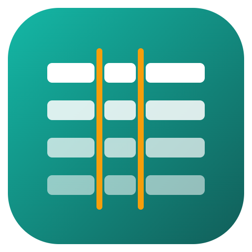

<h1 align="center">Kugiri Studio</h1>

固定長・CSV・HL7 の I/F ファイルビューア・エディタ（無料・Windows / Mac）

---

このリポジトリは **Kugiri Studio の配布用**です。ソースコードは置いていません。
最新版は [Releases](https://github.com/propropg/kugiri-studio/releases/latest) からダウンロードできます。紹介ページ：https://kugiri-studio.propropg.workers.dev/

## 入手

| OS | 入手方法 |
|---|---|
| Windows 10（1809 以降）/ 11 | [Releases](https://github.com/propropg/kugiri-studio/releases/latest) のインストーラ（`KugiriStudio-Setup-<版>.exe`）・ポータブル版（`KugiriStudio-Portable-<版>-x64.zip`） |
| macOS 12 以降 | [Releases](https://github.com/propropg/kugiri-studio/releases/latest) の dmg（Apple Silicon 用 `-arm64.dmg` / Intel 用 `-x64.dmg`） |

インストーラ・ポータブル版・dmg はコード署名をしていないため、初回の起動時に Windows SmartScreen や macOS Gatekeeper の確認が出ます。許可の手順は、配布ファイルに入っている「はじめにお読みください」をご覧ください。

## できること

- **固定長**：I/F 仕様書の表を貼り付けてレイアウト定義を作り、Shift_JIS のバイト数で項目ごとの表に。ヘッダ・明細・トレーラを種類ごとに表示
- **確かめたい行**：全角の途中で切れた項目・文字化け・短いレコード・数値の項目の文字に印を付けて絞り込み
- **セット**：複数の行で 1 件のデータを、キーや「始まり」の行でまとめて表示。CSV に書き出し
- **比較**：改修前後のファイルを、キー・項目の値で行を対応づけて比べる
- **EBCDIC**（IBM 939・930・037）と、ゾーン10進・パック10進（COMP-3）・2進（COMP）の読み書き
- **CSV・TSV・HL7**、伏字、重複の検出、テストデータの作成
- 直した項目以外は元のバイトのまま保存。ファイルの内容を外部に送信しません

## 使用許諾条件・免責事項

- **無料**で使えます（個人・会社とも。業務での使用を含みます）
- 改変・他のソフトウェアへの組み込み、販売・有償での配布、改変したものの配布、リバースエンジニアリングは禁止です。配布されたファイルを改変せず、無償で他の人に渡すことはできます
- オープンソースではありません。詳しくは、配布ファイルに同梱の「使用許諾条件（LICENSE）」をご覧ください
- **Kugiri Studio はファイルの内容を直接書き換えるツールです。使用によって生じたデータの消失・破損などについて、作者は責任を負いません。** 大切なファイルを編集する前に、必ずバックアップを取ってください

---

## English

This repository hosts the **downloads of Kugiri Studio** (no source code), a free viewer/editor for fixed-length, CSV, TSV and HL7 interface files. The user interface is in Japanese only.

- **Windows 10 (1809+) / 11**: installer / portable zip on [Releases](https://github.com/propropg/kugiri-studio/releases/latest)
- **macOS 12+**: dmg on [Releases](https://github.com/propropg/kugiri-studio/releases/latest) (`-arm64` for Apple Silicon, `-x64` for Intel)

Free for personal and commercial use. Modification, resale, paid redistribution and reverse engineering are not permitted. This is not open source software. Always back up important files before editing them.

© 2026 propropg
